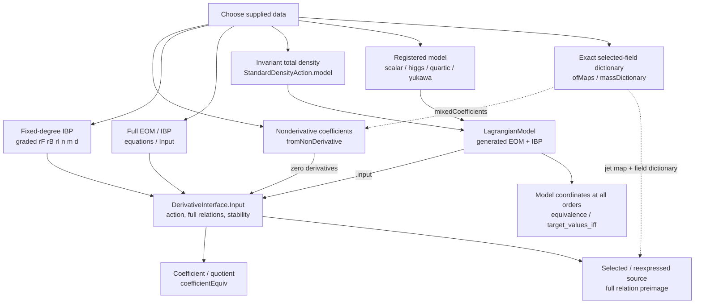
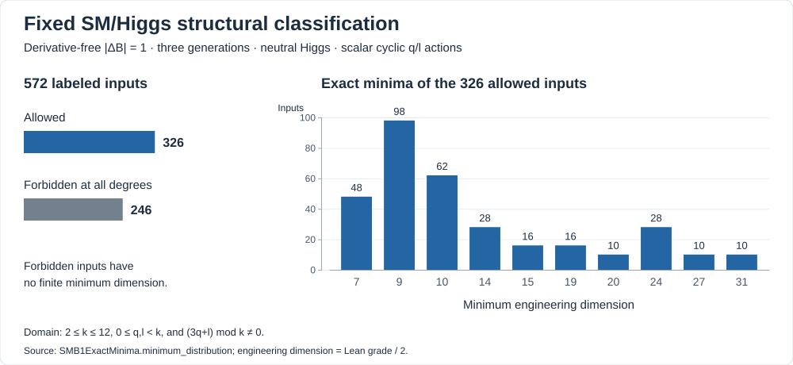
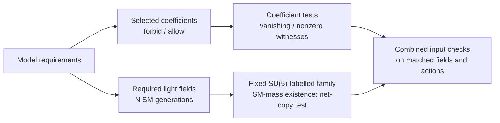
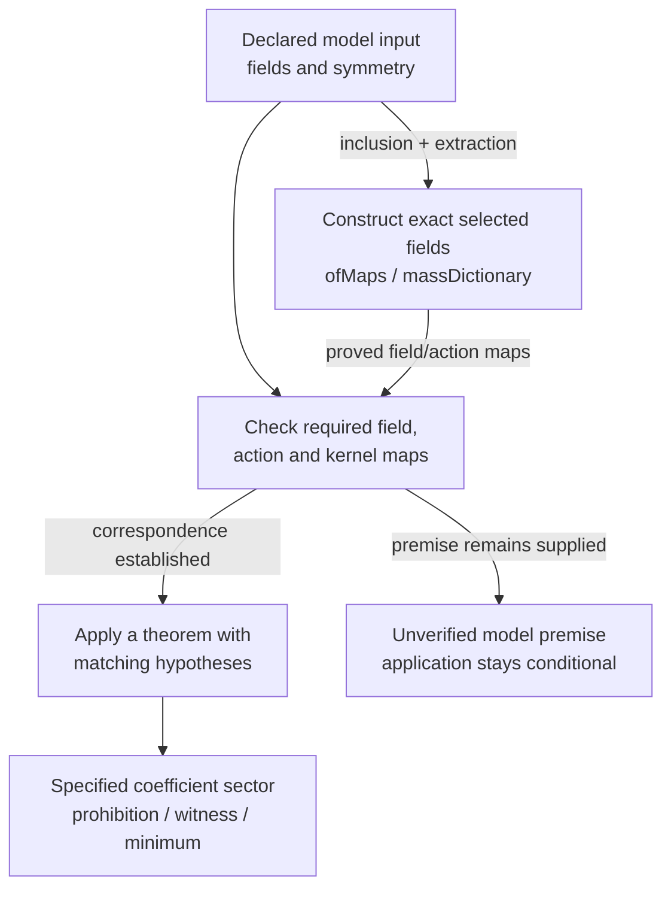
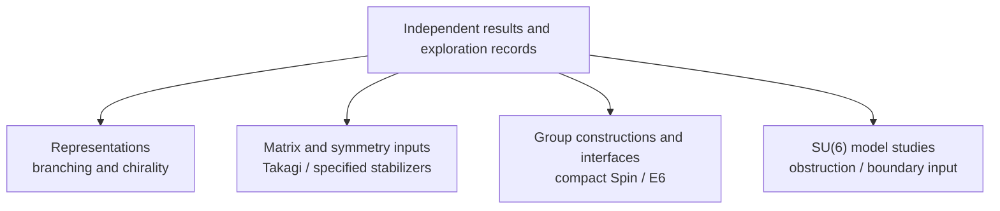

# Algebraic Operator Coefficients and Symmetry Criteria in Lean4

## Overview

A Lean formalization of operator coefficients with and without derivatives,
symmetry selection rules and their applications to specified field and model
inputs. Derivative inputs include equations of motion (EOM) and integration
by parts (IBP).
The project connects general algebraic theorems with exact structural tests
and conditional model checks. Allowed coefficients do not by themselves
establish generated interactions or decay rates.

[Changes and migration for `publish/v1.0` users](docs/UPGRADING.md)
cover the new inputs, toolchain update and temporary compatibility stubs.

## General Theorems

For derivative-free operators, coefficient extraction and reconstruction
identify invariant coefficients with residual intertwiner spaces at every degree:

$$
\mathcal C_{n,m}^{G\times H}
\simeq \prod_{c\in\mathrm{Content}(n,m)}\mathrm{Hom}_H(Q_c,\mathbb C).
$$

Symmetry extension is characterized by surjectivity of restriction:

$$
\mathcal C^K=\mathrm{res}_{H\to K}(\mathcal C^H)
\quad\Longleftrightarrow\quad
\mathrm{res}_{H\to K}\text{ is surjective}.
$$

All-degree charge selection rules also force invariant coefficients to vanish
when an actual symmetry element acts on their domain by a scalar other than one.

[General theorems, definitions and assumptions](docs/proof/current/GENERAL_THEOREMS.md).

For mixed Bose/Fermi jets, extraction and reconstruction also apply modulo
full EOM and IBP relations. The [all-order extension](docs/proof/current/core/Math/INTERACTING_LAGRANGIAN_COORDINATES.md)
gives exact, potentially infinite linear coefficient constraints, including
polynomial interactions that mix degrees.

## Input Interfaces

The derivative-aware interface includes terms without derivatives. Existing
published derivative-free interfaces remain available.

Diagram routes are also available as ordinary links:

- [Nonderivative, graded IBP and full EOM inputs](docs/topics/derivative-interface-adapters/input-guide.md#choose-the-input-data), [common operations](docs/topics/derivative-interface-adapters/input-guide.md#use-the-same-operations) and [source selection](docs/topics/derivative-interface-adapters/input-guide.md#select-a-source-subspace).
- [Invariant density](docs/topics/euler-naturality/input-guide.md), [registered models](docs/topics/lagrangian-model-connections/input-guide.md#registered-models) and [model package](docs/proof/current/inputs/Math/LAGRANGIAN_MODELS.md).
- [Exact selected-field dictionaries and coefficient/jet transport](docs/proof/current/inputs/Physics/FIELD_CONNECTIONS.md), with [entry points and usage](docs/topics/model-input-connections/input-guide.md). Dashed arrows are optional transports; derivative use takes relations from the full input.
- [All-order coefficient coordinates and assumptions](docs/proof/current/core/Math/INTERACTING_LAGRANGIAN_COORDINATES.md).

| Entry and canonical import | Input and construction | Guide |
| --- | --- | --- |
| Operator/EOM input: `Math.DerivativeInterface` `import Math.RepresentationTheory.Jets.DerivativeInterface` | Supply field and symmetry data; for EOM, supply the full relation space and its stability proof. Graded IBP and full-source EOM routes share coefficient operations. | [Choose an input route](docs/topics/derivative-interface-adapters/input-guide.md) |
| Local polynomial Lagrangian: `Math.StandardDensityAction.model` `import Math.RepresentationTheory.Lagrangian.StandardDensityAction` | Supply the total density, linear field/direction group representations and a proof of density invariance. The constructor derives Euler equations, their covariance and full EOM/IBP relation stability. | [Invariant density input](docs/topics/euler-naturality/input-guide.md) |

The Lagrangian route admits arbitrary finite polynomial degree and ordinary
derivative order, with mixed Bose/Fermi fields and constant linear symmetry
actions. It returns the existing model input and its coefficient operations.

The automatic construction requires exact invariance of the evaluated polynomial
density; invariance only modulo total derivatives requires separate treatment.

For existing callers, the [upgrade guide](docs/UPGRADING.md) explains
preserved interfaces, deprecated compatibility stubs and canonical replacements.

## Finite Structural Classifications

For the fixed derivative-free three-generation SM/Higgs input with scalar
cyclic q/l actions, all-degree coefficient existence reduces to finite
structural conditions.
In particular, absolute $\Delta B=1$ allowance has the exact charge criterion

$$
\mathcal C_{|\Delta B|=1}\ne0
\quad\Longleftrightarrow\quad
\exists L\in\{-17,-15,\ldots,17\},\quad 3q+Ll\equiv0\pmod{k}.
$$

Here $k$ is the cyclic group order, $q,l$ are the quark and lepton charges
modulo $k$, and $L$ is the normalized lepton-number change.

The certified 572-input domain is $2\le k\le12$, $0\le q,l<k$, with
$3q+l\not\equiv0\pmod{k}$, excluding inputs that already allow dimension-six
QQQL coefficients. All 326 allowed cases in this domain have exact minimum
engineering dimensions **among derivative-free coefficients**; the remaining
246 inputs are forbidden at all degrees in that domain.

The figure reads the counts from the existing Lean theorems.
[Figure data and regeneration](tools/docs/README.md#structural-classification-figure).

[Structural classifications and minimum-dimension scope](docs/proof/current/DECIDABLE_CLASSIFICATIONS.md).

## Constraints on Model Inputs

The coefficient criteria can be read backwards: a requested prohibition
imposes necessary conditions on the supplied fields, symmetry and mass data.
For example, in the specified SU(5)-labelled $10,\overline5,40,50$ family
and its algebraic duals, existence of an SM-invariant symmetric mass with
exactly $N$ SM generations as its radical requires the net-copy condition

$$
(p_0-q_0,p_1-q_1,p_2-q_2,p_3-q_3)=(N,N,0,0).
$$

Within that fixed SM-restricted family the condition is also sufficient for
existence of some such mass; it does not construct an SU(5)-invariant UV mass.

Node details are also available through ordinary links:

- [Input constraints and converse boundaries](docs/proof/current/INPUT_CONSTRAINTS.md), [combined checks](docs/proof/current/INPUT_CONSTRAINTS.md#combined-requests-and-mass-constraints).
- [Coefficient input conditions](docs/proof/current/inputs/Math/PROHIBITION_INPUT.md).
- [Exact SM-mass existence condition](docs/topics/prohibition-converse-boundaries/copy-mass-results.md).
- [Combined allowance/prohibition requests](docs/topics/prohibition-patterns/catalogue.md)
  for |ΔB|=1 (B1), |ΔB|=2 (B2), |ΔL|=2 (L2) and prescribed
  lepton-flavor-violating (LFV) dipoles.

## Concrete Model Inputs

Specified cyclic and nonabelian actions provide concrete tests. The $S_3$
flavor sample has an actual nonzero qque coefficient:

$$
\mathcal C_{\mathrm{qque}}^{\mathrm{SM}\times S_3}\ne0.
$$

Ten candidate model groups have been checked with their model-to-input
premises and unresolved conditions recorded separately.

[Application guide](docs/proof/current/APPLICATION_GUIDE.md) and node details:

- [Model studies](docs/model-studies/README.md).
- [Model-to-input checks](docs/proof/current/APPLICATION_GUIDE.md#application-procedure), [matching theorem inputs](docs/proof/current/APPLICATION_GUIDE.md#representative-inputs).
- [Exact selected-field construction](docs/proof/current/inputs/Physics/FIELD_CONNECTIONS.md): inclusion, extraction and both inverse laws derive the dictionary and selected extraction covariance.
- [Proved coefficient consumers](docs/proof/current/applications/GUT/CONDITIONAL_MODEL_INPUT_CHECKS.md).
- [Unverified model premises](docs/topics/conditional-model-input-check/model-admission-results.md).
- [SU(6) standard-class obstruction](docs/model-studies/su6-protection/feasibility.md) and
  [boundary-selected protecting input](docs/model-studies/su6-protection/boundary-model.md).
  The latter constructs algebraic amplitudes and invariant internal contractions;
  analytic mixed-mode identification and quantum protection remain separate.

## Independent Proofs and Exploration Results

Reusable results from earlier investigations include branching and chirality
certificates, specified stabilizers and Takagi factorization of a complex
symmetric matrix:

$$
U^{T}MU=\mathrm{diag}(\sigma_1,\ldots,\sigma_n),
\qquad U^\dagger U=I,\quad \sigma_i\ge0.
$$

This subject map links to results with their individual assumptions and open
bridges.

[Result index and individual boundaries](docs/proof/current/RETAINED_RESULTS.md),
with ordinary links to each branch:

- [Branching and chirality dossiers](docs/proof/current/RETAINED_RESULTS.md#applications--gut).
- [Takagi factorization and stabilizers](docs/proof/current/inputs/Math/ASSUMPTIONS.md#full-unitary-majorana-stabilizers-and-takagi-existence).
- [Group constructions and interfaces](docs/proof/current/RETAINED_RESULTS.md#inputs--math).
- [SU(6) obstruction and boundary-input results](docs/model-studies/su6-protection/README.md).

## Literature and Comparison Findings

The [related literature and references](docs/proof/RELATED_LITERATURE.md)
map published work to the project’s results and their stated scope.
The [literature comparison findings](docs/verification/literature-findings.md)
summarize three formal comparisons: a printed-basis applicability boundary,
a normalization discrepancy under fixed definitions, and a conditional
coefficient mismatch, with assumptions and unresolved limits recorded separately.

## Development Approach

Formalization was carried out primarily with Codex (GPT-6 Astra and GPT-6.1
Sol), with reviews using Claude Code and ChatGPT at selected stages. The
[workflow](docs/architecture/WORKFLOW.md) and
[Lean tooling guide](docs/architecture/LEAN_TOOLING.md) describe the current
practices. These practices evolved during the project; the architecture
documentation is not a retrospective description of every stage.

## Build

See [build instructions](docs/architecture/BUILD.md).

## How the Project Developed

The project began with an LLM-assisted discussion of whether a specified
SU(6) model could protect proton stability by forbidding $\Delta B=1$
operators. The discussion led to the opposite conclusion under the proposed
assumptions. Formalizing that argument in Lean with Codex became the starting
point of this repository. The resulting no-go statements concern specified
model and symmetry classes; they do not exclude every SU(6) construction.

Making those assumptions precise required distinguishing chiral indices from
actual massless fields, and symmetry-allowed coefficients from interactions
generated by heavy-field exchange. Work on branching, mass kernels and
residual actions then led from individual nonzero operator witnesses to
necessary and sufficient conditions for entire coefficient spaces. Related
operator sectors exposed common algebraic structures, which became the
general derivative-free completeness and selection-rule theorems above.

The later work applied those theorems to fixed SM/Higgs inputs: finite support
tests, exact minimum dimensions in a specified cyclic domain, and conditional
checks of concrete model inputs. Comparisons with published expressions also
produced the [literature comparison findings](docs/verification/literature-findings.md). The original model-search question
thus grew into a framework for stating assumptions explicitly and checking
what follows from them. No protecting SU(6) model was established by the
investigated routes; broader constructions remain outside their scope.

Subsequent extensions added derivative/EOM/IBP inputs and local polynomial
Lagrangians while preserving the published derivative-free interfaces.

See the [research trajectory](docs/topics/proof-program-context/RESEARCH_TRAJECTORY.md)
and [SU(6) exploration boundary](docs/topics/sm-support-and-lfv-decomposition/su6-exploration-closure.md)
for the underlying records and qualifications.

## Project Context and Limitations

This is an individual project motivated by personal interest, developed with
LLM assistance by an author who is not a theoretical physicist. The author
does not claim complete understanding of all mathematical and physical
assumptions or of every statement formalized here, and cannot independently
vouch for their correctness or physical relevance.

Lean checks proofs of the encoded statements relative to their definitions,
explicit hypotheses and foundational axioms. This does not by itself validate
the physical assumptions, establish correspondence with a published model,
or ensure that an informal explanation accurately describes the formal result.
LLM-assisted reviews provide additional scrutiny but may share errors and are
not a substitute for independent expert assessment. Readers should inspect
the formal statements and their documented scope when using these results.

The formal results do not include RGE evolution, nonperturbative QCD,
hadronic matrix elements or lattice calculations; see the
[physical interpretation and exclusions](docs/proof/current/inputs/Physics/assumptions/physical-scope.md#physical-interpretation-and-exclusions).

## License

[Apache License 2.0](LICENSE). Third-party material retains its own licenses
and attribution requirements.
